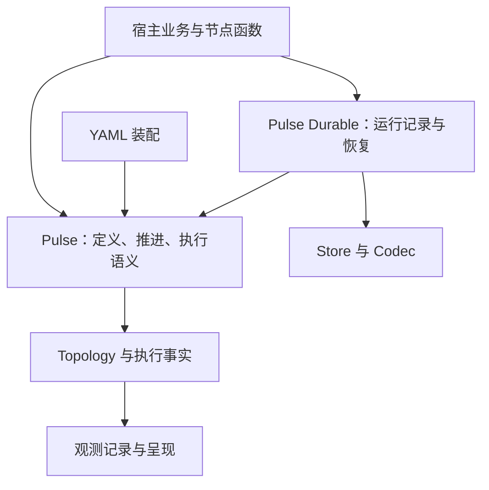

# Pulse 与 Pulse Durable：workflow-engine 的定位与演进

> 2026-10-12 · 设计定性与开发总纲 · [总票 #320](https://github.com/Luo-root/pulse/issues/320)
>
> 用户目标已明确：好用、理解简单、可观测性强，能力强且便于扩展，并逐步具备分布式能力。
> 本文将这个目标落成两仓职责、验收场景与开发顺序。**产品方向与发布路线已确认；具体 API / 数据契约按对应票定稿，尚未实现的能力不代表现状，公开 API 尚未整体冻结。**
> 当前实现见 [pulse.md](pulse.md)，已落地的对象模型与冻结契约见 [object-model.md](object-model.md)，设计公理见 [philosophy.md](philosophy.md)。

## 1. 设计定性

**Pulse 的产品方向是数据驱动、可观测、可组合的 Go workflow-engine 基座。**

`pulse` 提供可以嵌进 Go 程序的执行内核；`pulse-durable` 基于同一套定义与节点，逐步提供运行记录、检查点恢复、持久化等待和分布式运行管理。业务节点与接线应尽量沿用，升级能力主要发生在运行入口与环境配置上。

最容易理解的比方是工厂：Graph 是生产图纸，Node 是一道工序，Key 是工序之间交接的材料，Execution 是这一次生产；durable 保存这次生产已经交付的成果，以便停电后接着做。图纸不记录昨天生产到哪，运行记录也不另画一份不同的图纸。

“能力强”落实为：本地执行可以独立使用，恢复层可以独立安装，同一份语义能承受更强的运行管理。核心应完整负责它掌握的不变量，外围应有明确的接入契约。

### 谁会用它

- **服务开发者**：在一次请求或后台任务中，把读取、并行处理、分支与汇聚组合起来；运行结束后取得声明的结果。
- **需要恢复任务的人**：文档处理、数据导入或 AI 多步计算跑到一半进程退出；希望复用已提交结果，重做未提交的步骤。
- **值班与平台开发者**：随时知道哪个步骤在等输入、等名额、执行、重试或提交；按一次运行追踪，失败时定位原始原因。
- **需要扩大吞吐的人**：让多个 worker 分担不同工作流，某个 worker 停机后由其他 worker 接管；更后面再评估单张图跨机器执行。

前三种场景构成近期交付基础；最后一种是分布式演进目标。

## 2. 现状与目标分开

2026-10-13 核对：Pulse main 为 `7f99625`，阶段 4 已经整合 PR #326 合入；最后已核实 release 仍是 `v0.4.1`。以下区分主干能力与本地待提交成果；票关闭、实现完成、合并和发布是不同状态。

| 范围 | 已核实的现状 | 接续工作 |
|---|---|---|
| 定义与执行 | `Graph` 可复用；每份 `Execution` 有自己的输入、槽位、错误与取消域 | 保留这个边界，恢复也创建新 Execution |
| 静态组合 | `Sub` 挂现成子图，端口接线，运行前递归校验；完整声明端口已在阶段 4 合入 | 检查点恢复保持组合前后的子进度能力 |
| 重试 | attempt 写集已合入；本地桥接增加完整链暂存与持久 Retry 游标 | 评审本地可靠桥接与预算/作用域隔离 |
| 观测与分析 | Site、结构化记录、Execution Snapshot、Mermaid、无注册表 YAML Analyze 均已合入 | 恢复事实由 Durable 自身事件提供，不伪造业务耗时 |
| 调用方取得结果 | `ReadOutput` 与 Wait 真实取消收尾修复已本地实现并验证 | 按 #321/#327 提交评审，不将未发布 API 说成已发布 |
| Durable 首期 | Store/Codec/MemoryStore、Run/Resume、方案 A、文件后端与七个真实退出/重启场景已本地实现和联调；远端仓库仍未提交本组代码 | 按 #2–#5 拆分可评审提交，维护者决定合并与发布 |
| 分布式 | 没有跨机器任务派发、worker 租约/fencing 或故障接管实现 | 单独定义持久身份、领取、续约、接管与旧写拒绝 |

Core 依赖仍为标准库；桥接行为通过跨仓实际组合验证，MemoryStore 不冒充进程恢复。完整机制和验收场景见 [检查点桥接与子图恢复（方案 A）](checkpoint.md)。

Durable `v0.1.0`（首期）采用**显式整图启用、按节点保存检查点**，强制对子执行继承，不支持普通/Durable 节点任意混搭。注册 Codec 的非流式值可恢复；已确认节点跳过业务链，未确认节点从函数开头重进。维护者已选择方案 A：重启认回原活跃父尝试，明确失败的新 Retry 分配新作用域。暂停、Signal、任意 Go 调用栈恢复、stream 恢复与任意值自动序列化均不在首期范围。见 [durable #1](https://github.com/Luo-root/pulse-durable/issues/1)。

## 3. 两个仓库的职责

| 层 | 掌握什么 | 负责什么 |
|---|---|---|
| `pulse` | 静态图、声明权限、类型、执行槽位、节点链、到达与取消 | 静态正确性、推进、Retry 隔离、完成/跳过/失败判据、状态与事件、可靠提交及恢复原语 |
| `pulse/observe` | 引擎发出的事实 | 折成记录、计时、输出与呈现；观察者异常不改执行结果 |
| `pulse/yaml` | 声明式定义与工厂登记 | 装配同一种 Graph，共用结构校验与视图 |
| `pulse-durable` | 长期运行记录、编码后的数据、Store、稳定运行身份 | 检查点提交、兼容性校验、Run/Resume、并发恢复协调；后续管理等待、唤醒与 worker 所有权 |
| 宿主业务 | 数据含义、外部服务、业务事务 | 节点业务体、外部副作用幂等/事务/补偿、部署和业务权限 |

依赖方向单向：`observe`、`yaml` 与 `durable` 使用 `pulse`；`pulse` 不 import 它们。根包保持标准库依赖；存储驱动与网络协议在扩展层。

图是职责示意。Durable、Store 与跨仓桥接已本地实现和联调，尚未合并或发布；Facts 的按需执行快照已随阶段 4（#319、#326）合入主干。

### “没有中心调度循环”约束哪一层

当前核心为每个节点启动 goroutine，通过输入槽位的到达推进。这是**本地数据流执行机制**，也是现有 API 的语义基础。

将来 durable 为等待中的工作流登记唤醒时间、让 worker 领取任务、在停机后接管，属于**运行管理**，允许有队列、扫描与调度。两层各自只维护自己负责的事实；durable 不应重新实现 Key 到达门闩，核心也不负责数据库任务领取。

“没有调度循环”不应被扩成整个产品永远不能管理任务的禁令。具体本地推进实现若遇到规模瓶颈，以实测决定优化；公开语义仍须保持。

## 4. 保留的设计思想与重构准则

1. **读写声明决定依赖。** Graph、Node、Key、Execution 保持主模型；边与顺序是视图。业务代码不重复维护连线表，扩展层不制造第二套拓扑。
2. **定义可复用，运行独立。** 跨轮状态进入 durable 或宿主；不放回 Graph，不清空旧槽位重跑 Execution。进程重启后重建等价定义，再创建新 Execution。
3. **到达只有 ready/skipped，pending 继续等待。** 所有必需输入到达后才判门；至少有一路值就进入 Run，全部跳过才自动跳过。严格汇聚仍显式声明。恢复必须保存跳过这一正常事实。
4. **失败与跳过始终可区分。** 节点失败、检查点提交失败、worker 所有权丢失各有可定位的原因，不能伪装成“这一路没有值”。
5. **可静态判定的错误尽早报。** 类型、来源、端口、环和组合约束留在装配/启动检查；持久模式的 Codec/恢复兼容性在允许业务体执行前完成必要检查。
6. **观察事实与控制提交分开。** Observer 继续是只读事实出口；可靠提交是能阻止发布、返回错误的执行契约。一个日志出口失败可以被隔离，一个可靠检查点失败必须阻止未确认结果发布。
7. **以具体写错与重复劳动评价 API。** 先解决“怎么取得这轮结果”“如何看卡在哪”“如何切换成可恢复运行”；公开面跟真实使用场景增长，内部写集不开放为通用插件插槽。
8. **保证要有前提与反例。** 延续冻结面、LF、文档示例闸门、并发回归和变异对照。跨仓契约用实际组合验证，不能只各自 mock 对方。

这些原则保留已有设计成果；本轮先补产品定位与恢复边界，并不要求重新实现已经通过验证的数据流内核。

## 5. 重试与持久化是两道不同的交付关口

假设一道工序产出 A、B 两份材料。它第一次做出了 A 却失败，第二次做出了完整结果。

**Retry 管的是“哪一次尝试算数”。** 每次尝试先放自己的临时成果；失败的丢弃，成功的交给上一层。当前普通模式下，最外层 Retry 会把成功结果逐键发布到 Execution。

**Durable 管的是“这一道工序的最终结果是否已经可靠记录”。** 业务体返回后，外层切面仍可能失败；即使 Retry 成功，也不能提前认定整个节点成功。显式启用 Durable 后，完整节点链的写入都须在节点暂存范围内，Retry 成功只合并到这个范围。

目标顺序沿用 [Pulse #307](https://github.com/Luo-root/pulse/issues/307) 与 [durable #1](https://github.com/Luo-root/pulse-durable/issues/1)：

1. 执行完整节点链，包括所有内外层切面；每个 Retry attempt 保持自己的隔离。
2. 引擎确定节点最终结果，补齐所有未写出口的正常 skipped 状态；失败路径按独立契约处理。
3. durable 编码并原子记录可恢复的节点终态与**全部**输出状态和值。
4. Store 确认提交成功，核心才把这份结果发布给下游；提交失败时阻止未确认结果发布，带出错误。

普通模式仍保留当前即时发布语义；持久模式显式选择节点完成后发布。这是有意的模式差异。渐进式输出与 channel 需要独立协议，不能把持久模式的限制静默施加给所有图。

三种“原子”要分清：Retry 丢弃保证失败尝试不可见；检查点原子记录保证持久化中没有半个节点；运行时逐键发布仍可能出现“一条 ready、另一条 pending”的窗口。前两种保证不自动推出所有槽位在同一瞬间可见。

### 崩溃时到底恢复什么

- **检查点尚未提交**：这一步可能已调用外部系统，恢复时仍允许重新执行；外部副作用需要幂等、事务或 outbox。
- **检查点已提交、尚未发布**：新 Execution 从检查点恢复完整结果，业务体不重做，然后继续下游。
- **已经提交并发布**：同样复用检查点；下游各自按它自己的提交状态决定恢复或重做。
- **Store 读取/提交出错**：不能把故障当作没有历史，也不能用无检查点的普通执行兜底；应停止推进并报告存储问题。

持久运行保存的是节点成果及运行记录，不是 Go 调用栈。无法自动续接业务函数内部执行到某一行的位置。

副作用方案也有前提：**单独包一个业务事务，仍关不住“业务已提交、检查点没提交”的重做窗口**。要防重，应把业务变更与稳定防重记录纳入同一原子边界，或在能够共同提交的前提下与检查点协调。outbox 需要业务变更与消息记录可靠地一起提交，事件身份稳定、投递可重试，消费端按身份去重或幂等；只增加一个 outbox 表并不自动保证外部动作只发生一次。

### 已落成本地实现的恢复契约

[durable #2](https://github.com/Luo-root/pulse-durable/issues/2) 与 [Pulse #307](https://github.com/Luo-root/pulse/issues/307) 已统一采用方案 A，详见 [桥接契约](checkpoint.md)：

- 每次新建 Execution，进程重启重建等价 Graph；完成与正常跳过才是可恢复节点成果。
- 全部 Provides、状态、真实类型和依赖集合整批校验；恢复跳过完整业务链及 Commit，只发实际 Finished，Durable 另发恢复事实。
- 认回持久父尝试及嵌套 Retry 游标，同一作用域保留子进度，新失败尝试与旧成果隔离；最终根失败不通过 Resume 刷新次数。物理回收不参与正确性。
- RunID 稳定，业务 Version 显式必填；结构/输入/Codec 指纹先核对。Go 函数、闭包、固定值与切面语义由宿主版本负责。
- Store 独占会话覆盖完整执行过程，原子 CAS 更新完整记录；本机文件后端使用 OS 锁。分布式租约/fencing 与跨 worker 自动接管仍是后续协议。

这些是实际接线的前提，不留给 Store 实现者自行猜。公开面随评审收敛，尚未整体冻结或发布。

## 6. 将“好用、易懂、可观测、可扩展”变成验收

| 目标 | 开发者实际需要完成什么 | 验收方式 |
|---|---|---|
| 好用 | 定义一次、传入这轮输入、取得声明输出；不用靠共享闭包保存结果 | 一个可运行的调用方示例，顺序/并发两轮结果隔离，缺值与失败分开 |
| 易懂 | 分清图纸、这次运行、这次尝试、长期运行记录 | 快速入门只先讲 Graph/Node/Key/Execution；Durable、Store 与 Codec 随使用需要引入 |
| 可观测 | 中途接入也能问状态，定位节点与输入；同名子图和两轮运行不混 | 静态树、快照与 Site 路径一致；事件和状态同源；每份执行单独归因 |
| 可恢复 | 重启后已提交的不重做，未提交的按约定重做 | 真实进程退出并重启的示例，存储故障与 Codec 失败注入，副作用窗口有幂等证据 |
| 可扩展 | 替换存储/呈现而不复制执行状态机；普通模式独立运行 | 跨仓提交/恢复契约测试，根包依赖仍为标准库，未启用 Durable 时原行为回归 |
| 分布式 | 多 worker 按有效所有权分工；接管后旧 worker 不能再提交有效结果 | 双 worker 争抢、失联后接管、旧 worker 回来提交被存储端原子条件写拒绝 |

强观测至少应能回答：在跑哪份定义、哪一次运行、哪处挂载、为什么还没推进、真实失败是什么、哪份结果是恢复出来的。

当前生命周期回调不是完整 attempt 历史；#319 先补按需快照。后续要回答“重试到第几次”“等检查点还是等事件”“从哪个 checkpoint 恢复”，应由掌握事实的层补记录/只读出口，不重复发送冻结的节点生命周期三连。durable 事实通过它拥有的 Attrs 键和查询记录提供，真实业务值默认不进入观测。

### 结果读取要守住端口边界

宿主类型化声明出口读取已按 [#321](https://github.com/Luo-root/pulse/issues/321) 实现为 `ReadOutput(e, key)`（主干合入 / 发布状态以对应 PR 与 release 为准）。它与只含状态的 Snapshot 分开：出口是用户声明的公共结果，内部 Key 仍是实现细节。

主路径成功 Wait 后立即读取：返回业务值、既有 SlotState 与 error；ready 包含零值和 nil，正常 skipped 与未喂的可选透传 pending 都不报失败。不等待、不造槽、不把 pending 偷换成 skipped；未收尾和真实失败/取消不返回部分值，同名同类型键等价且必须是本图声明出口。Wait 先锁存终态再释放 ctx（#327），正常资源释放不污染结果；可变业务值不深拷贝。完整契约见 [pulse.md 的结果读取](pulse.md#62-宿主结果读取readoutput)。

## 7. 分布式分两步，长等待也有自己的边界

### 第一档：多 worker 分担工作流，并能接管

例如有一百个独立订单：worker A 处理其中一批，worker B 处理另一批；每个订单的图先在一个 worker 内运行。A 停机后，B 取得相应运行的所有权，加载检查点，用新 Execution 继续未完成部分。

这已经解决横向吞吐与故障接管，不要求把一次数据交接改成跨机器消息。

需要先具备持久后端，以及稳定运行身份、定义/代码版本、可领取任务、租约续约和过期接管、存储端旧写拒绝、重试/去重与统一查询。MemoryStore 只验证契约，不能证明真实进程重启或跨机器协调。

**仅有租约或“同一 RunID 的写入唯一”不够。** A 失联后 B 接管，A 恢复网络时仍可能拿着旧结果提交。新的所有权必须带可校验的递增令牌/版本。**Store 对当前所有权的校验与受保护写入，必须是同一原子条件操作，并与接管的版本更新协调**；不能先读版本、再普通写入——否则 A 查过旧版本后，B 接管，A 的旧写仍可能落库。验收要主动安排这个交错窗口。令牌拒绝过期提交，不能只让 A 自觉停下；CAS 协调一个短写入，也不自动等于独占整个外部业务执行过程。

当前 Execution ID 由进程内序号生成，不是跨机器稳定身份。建议保持 durable RunID 跨恢复不变，给每次实际执行分配跨进程可区分的身份，并将 worker 与父 attempt 关联进记录；独立 WorkflowID 是否有必要，等确有“一个业务工作流包含多次 Run”的使用场景再定，不先造同义 ID。

令牌只能保护引擎记录与提交目标，无法自动阻止旧 worker 已发出的 HTTP、支付或邮件；外部系统仍需认幂等键或相应业务协议。

### 第二档：同一张图的节点跨机器

例如解析步骤在 CPU worker，推理步骤在 GPU worker，汇聚在另一台机器。它新增跨机器数据传递、任务确认、能力路由、大值引用、节点取消、背压与失败传播等问题。

这一档应在第一档可靠后，由真实的算力/隔离场景推动，另立任务派发与数据协议。不能把 Go channel 或任意函数闭包当成可远程传递的对象，也不能承诺冻结的内存 slot 直接变成共享远端槽。

### 长时间等待、循环与动态批量

“等待人明天审批”需要保存等待条件、关联事件与消费/超时事实，让运行暂时释放本地资源，再按持久记录唤醒。它不能只靠 goroutine 睡一天获得重启保证。未来应定义明确的挂起边界与重入协议；等待是正常状态，不是 skipped，也不是故障。

“循环直到满足条件”与“按这轮数据生成 N 项任务”需要持久的迭代/子任务身份。现有 Graph 是有限的无环静态定义、slot 一次到达即终结；建议由 durable 管理多轮 Execution/子任务记录，或者未来另定受控动态执行契约，不在运行期修改共享定义、不重开旧槽位。

这些是下一阶段设计方向；Durable 首期的普通 Run 仍可等待外部条件，但没有持久挂起/唤醒保证。它们的 checkpoint 单元、并行汇聚与回收规则必须在实施票中定义后再写代码。

## 8. 演进顺序与可交付产物

| 顺序 | 交付成果 | 现有载体 / 新增设计 |
|---|---|---|
| 0 设计定性 | 本文与两仓职责、现状矩阵、验收场景 | [Pulse #320](https://github.com/Luo-root/pulse/issues/320) |
| 1 本地易用与观测 | Snapshot、端口视图、Mermaid、YAML Analyze；另外定稿声明出口读取 | [Pulse #319](https://github.com/Luo-root/pulse/issues/319)；[结果读取 #321](https://github.com/Luo-root/pulse/issues/321) |
| 2 核心可靠交付 | 完整节点暂存/最终化、检查点成功后发布、启动前恢复；先定子图 attempt 归属 | [Pulse #307](https://github.com/Luo-root/pulse/issues/307) + [durable #2](https://github.com/Luo-root/pulse-durable/issues/2) |
| 3 Durable 首期（目标 `v0.1.0`） | Store/Codec/MemoryStore、Run/Resume、故障注入与端到端契约 | [durable #3](https://github.com/Luo-root/pulse-durable/issues/3)、[#4](https://github.com/Luo-root/pulse-durable/issues/4)、[#5](https://github.com/Luo-root/pulse-durable/issues/5) |
| 4 真实长期运行 | 本机文件后端与进程重启已纳入首期验收；后续另定生产持久后端、持久等待/事件/定时唤醒 | 文件后端不代表分布式所有权或断电保证；后续能力独立开票 |
| 5 分布式运行 | 多 worker 工作流领取、租约、接管、旧写拒绝与统一观测 | [durable #6](https://github.com/Luo-root/pulse-durable/issues/6) 先定运行所有权协议，不与节点跨机器混在同一票 |
| 6 受场景驱动的扩展 | 跨机器节点、动态子任务、迭代、显式补偿等 | 按实际需求各自定契约，不预先铺通用插件框架 |

实现按小组能力切可评审 PR；阶段交付边界与发布边界分开。阶段 1/2/3 的成果尚未随新版本发布；阶段 4 已实现（#319），主干合入 / 发布状态以对应 PR 与 release 为准。发版不由阶段编号自动触发。

### 已确认的发布路线与闸门

1. **首期桥接版本：Pulse `v0.5.0` 与 `pulse-durable` `v0.1.0`。** 先完善 Pulse 当前能力，预留并定稿 Durable 桥接契约，再完成两仓整套桥接联调；联调没有重大问题后，才进入这两个版本的发布。阶段完成、PR 合并或单独通过 MemoryStore 契约测试，都不自动触发发版。
2. **首期之后继续 0.x。** 两仓继续按实际功能与问题迭代 0.x 版本。每次发布前先把本版的功能和需求写清，完成实现、回归和跨仓组合验证，再由维护者决定发布；不要为了阶段编号或单个 PR 提前打版本。
3. **最终 `v1.0.0` 冻结。** 等项目目标达到，并确认后续不再有系统性重大变更，再补齐详细文档体系，发布两仓各自的 `v1.0.0`；届时基本固定公开 API 与实现。在此之前，任何 0.x 版本都不代表最终冻结。
4. **恢复能力的证据口径。** MemoryStore 只证明 Store/Codec/Run/Resume 契约。只有真实持久后端完成真实进程退出并重启后的恢复验证，才可以声称能够抵御进程退出；发布说明和验收记录都必须守住这条边界。

近期首先接续 #319；#307 与 durable #2 的契约可并行评审，但需核心恢复/提交原语验证后再完成 durable Run/Resume 接线。Durable 桥接尚未实现，MemoryStore 的里程碑只叫契约实现；有真实持久后端和重启验证之后，才声称可以抵御进程退出。

## 9. 选型对照与可推翻条件

本轮阅读了两条官方路线：

- [Temporal Tasks](https://docs.temporal.io/tasks)：worker 按事件历史重放工作流决策，历史中的 Activity/Timer 结果在重放时直接返回。
- [DBOS Go Workflows](https://docs.dbos.dev/golang/tutorials/workflow-tutorial)：步骤结果与运行记录支持恢复；通过运行句柄取得结果；工作流代码有确定性与版本兼容要求。

Pulse 已有显式静态图、声明 Key 和独立 Execution，先做节点检查点恢复能直接复用这些资产。目标不是复制任意 Go 程序的确定性重放，也不是完整比较或替代上述产品。

选择有三条路：保持现状投入最小，但缺少长期运行的一致边界；按本文分层增加可靠交付与恢复，需要少量核心原语与跨仓契约；立即做完整中心服务/远程节点平台，部署与协议复杂度更高，当前尚无必要性证据。近期选择第二条。

如果真实用例证明静态图无法表达核心用户场景，或者节点检查点不能提供所需等待/迭代恢复，应拿可复现的场景回到设计票，评审新的执行契约。保留公开不变量，不把当前实现偏好当作永久禁令。

## 10. 证据与文档分工

- 实现定位：[graph.go](../../graph.go)、[execution.go](../../execution.go)、[node.go](../../node.go)、[writeset.go](../../writeset.go)、[observer.go](../../observer.go)、[topology.go](../../topology.go)。
- 对象模型与已合阶段：[Pulse #311](https://github.com/Luo-root/pulse/issues/311)、[PR #318](https://github.com/Luo-root/pulse/pull/318)、[object-model.md](object-model.md)。
- 快照与静态分析：[Pulse #319](https://github.com/Luo-root/pulse/issues/319)。
- 核心持久模式：[Pulse #307](https://github.com/Luo-root/pulse/issues/307)。
- Durable 设计链：[#1](https://github.com/Luo-root/pulse-durable/issues/1)、[#2](https://github.com/Luo-root/pulse-durable/issues/2)、[#3](https://github.com/Luo-root/pulse-durable/issues/3)、[#4](https://github.com/Luo-root/pulse-durable/issues/4)、[#5](https://github.com/Luo-root/pulse-durable/issues/5)。
- 远端 durable 状态：[仓库](https://github.com/Luo-root/pulse-durable)、[contents API](https://api.github.com/repos/Luo-root/pulse-durable/contents)、[branches API](https://api.github.com/repos/Luo-root/pulse-durable/branches)，本轮返回空仓/空分支。

本文负责**产品方向、职责与开发顺序**；philosophy.md 负责**已有设计公理及代价**；object-model.md 负责**Graph/Execution 迁移的阶段契约**；pulse.md 负责**今天实际可用的实现**。能力落地时先更新对应现状，再改路线状态，避免让用户把目标当成 API。
