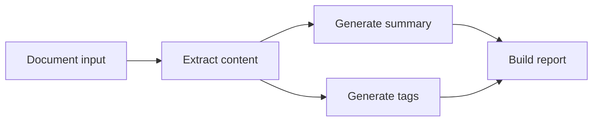

# Introduction

Pulse is a data-driven workflow execution library for Go. Split business logic into nodes, declare the data each node needs and produces, and let Pulse advance execution from those declarations. Inspect structure, state, and events through its read interfaces.

This guide is for Go developers who need multi-step processing inside an existing application. Familiarity with functions, generics, and `context.Context` is sufficient to begin.

## A typical workflow

Consider an application that accepts a document, extracts content, generates a summary and tags, then builds a report. Summary and tagging both depend on the extracted content and can run concurrently. The report waits for both routes to provide a value or explicitly skip.

Each data item has a `Key[T]`. The extraction node declares a content output; summary and tagging declare the same content key as an input. These declarations determine the dependencies, without a separate wiring table.

Keep the workflow definition and create a new `Execution` for each request. Supply that request's inputs and wait for completion. Execution state is isolated; application code still owns shared clients, captured objects, and mutable business values.

## Available capabilities

| Capability | Purpose | Guide |
| --- | --- | --- |
| Inputs, outputs, and typed data | Define the interface between the host and workflow | [Inputs and outputs](inputs-outputs.md) |
| Branching, parallel work, and aggregation | Compose routes and choose a missing-value policy | [Branches and joins](branching.md) |
| Retries, timeouts, and concurrency quotas | Control node execution and cancellation | [Retries and cancellation](retry-cancellation.md) |
| Static subgraphs | Reuse a complete workflow through declared ports | [Subgraphs](subgraphs.md) |
| Channel streams | Transfer a sequence during one execution | [Streams](streams.md) |
| YAML assembly | Separate topology configuration from Go functions | [YAML assembly](assembly.md) |
| Events, logs, and snapshots | Inspect progress, diagnose failures, and integrate logging | [Observation](observability.md) |

The core uses only the standard library. Import the optional `observe` and `yaml` packages as needed. For recovery after a process exits, use the separate [pulse-durable](https://github.com/Luo-root/pulse-durable) library. It provides local checkpoint storage and recovery; durable waits and distributed run management are not implemented.

## Reading paths

**For a first workflow**, read [installation](installation.md), the [quick start](quickstart.md), and [core concepts](concepts.md). The quick start includes a complete program, commands, and expected output. The concepts page explains the data model behind it.

**For an existing workflow**, choose a task from the [usage guides](orchestration.md). Each page explains the operation, required declarations, and common mistakes. You do not need to read every chapter in order.

**For precise guarantees**, use the [reference](../reference/index.md). Lifecycle rules, error categories, the checkpoint protocol, and version differences live there. Source godoc documents each exported symbol's signature and contract.

**For design contributions**, read [design philosophy](philosophy.md) and the [design materials](https://github.com/Luo-root/pulse/tree/main/docs/design). They explain trade-offs and history; they are not prerequisites for a first run.

## Documentation version

These pages use v0.5.1 as their API baseline, including the complete reusable-definition and independent-execution object model. [Installation](installation.md) explains how to pin a version, select subsequent development changes, try unmerged local source, and check the selected dependency.

Next: [Install Pulse](installation.md).
