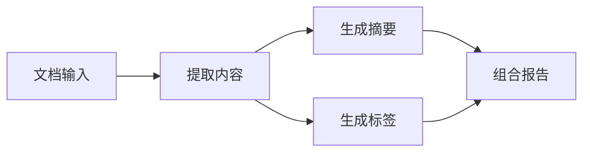

# 介绍

Pulse 是用于 Go 程序的数据驱动工作流执行库。你把业务拆成节点，声明每个节点需要哪些数据、会产生哪些数据，Pulse 根据这些声明推进执行，并提供结构、状态和事件视图。

本指南面向需要在现有应用中组织多步骤处理的 Go 开发者。开始前，你只需要了解 Go 函数、泛型和 `context.Context`。

## 一个典型场景

假设应用要接收一份文档，提取内容，再分别生成摘要和标签，最后组合报告。摘要和标签都依赖提取结果，二者可以并行工作；报告要等待两路都明确提供结果或跳过。

在 Pulse 中，每条数据由 `Key[T]` 标识。提取节点声明输出内容，摘要与标签节点声明读取同一个内容 Key，依赖关系便随之确定。你无需另写一份节点连线表。

工作流定义可以长期保留。每次请求创建一份新的 `Execution`，提供本次输入并等待结束；不同执行的运行状态彼此独立。业务函数捕获的共享对象、客户端和可变数据仍由应用管理。

## 你能使用哪些能力

| 能力 | 用途 | 文档 |
| --- | --- | --- |
| 输入、输出和类型化数据 | 定义宿主与工作流的接口 | [输入与输出](inputs-outputs.md) |
| 分支、并行和汇聚 | 组合多路处理，明确缺值策略 | [分支与汇聚](branching.md) |
| 重试、超时、并发额度 | 控制节点执行和取消 | [重试与取消](retry-cancellation.md) |
| 静态子图 | 复用完整流程，通过端口连接 | [组合子图](subgraphs.md) |
| channel 流 | 在同一次执行中持续传递数据 | [流式处理](streams.md) |
| YAML 装配 | 将拓扑配置与 Go 处理函数分开 | [YAML 装配](assembly.md) |
| 事件、日志和快照 | 查询进度、定位故障、接入现有日志 | [图观测](observability.md) |

核心包只依赖标准库。`observe` 与 `yaml` 是可选包，按需引入。需要跨进程恢复时，可使用独立的 [pulse-durable](https://github.com/Luo-root/pulse-durable)；它提供本机检查点存储和恢复，持久等待与分布式运行管理尚未实现。

## 怎样阅读本文档

**第一次使用**，依次阅读[安装](installation.md)、[快速开始](quickstart.md)和[核心概念](concepts.md)。快速开始包含完整程序、运行命令和预期结果，概念页解释程序背后的数据模型。

**已经有一个工作流**，从[使用指南](orchestration.md)选择当前任务。各篇解释操作方式、需要声明的接口以及常见错误，不要求从头读完整套文档。

**需要核对具体保证**，查看[参考](../reference/index.md)。生命周期、错误分类、检查点协议和版本差异集中在那里。源码中的 godoc 提供每个导出符号的签名与契约。

**准备参与项目设计**，阅读[设计理念](philosophy.md)和[设计资料](https://github.com/Luo-root/pulse/tree/main/docs/design)。这些材料解释取舍与历史，不作为完成第一次运行的前提。

## 文档版本

本文档以 v0.5.0 为 API 基线，包含可复用定义与独立执行的完整对象模型。[安装页](installation.md)说明如何固定安装版本、选择后续开发改动、试用尚未合并的本地源码，以及核对实际依赖。

下一步：[安装 Pulse](installation.md)。
